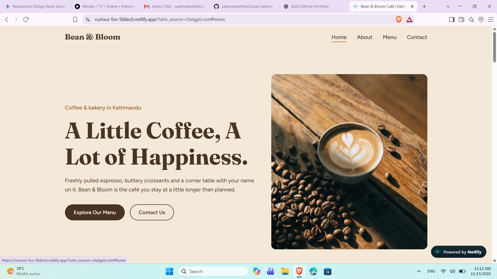
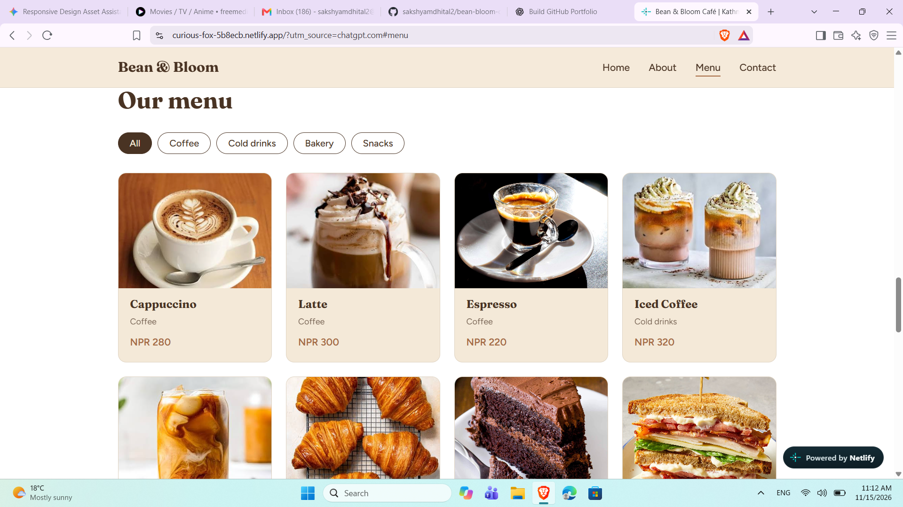
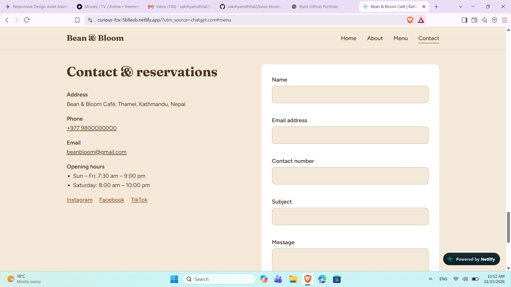

#  Bean & Bloom Café

A modern, responsive café and bakery website designed for **Bean & Bloom Café**, located in Thamel, Kathmandu, Nepal.

Built using HTML5, CSS3 and vanilla JavaScript, this project focuses on clean design, attractive product displays and a smooth user experience across desktop and mobile devices.

## Live Demo

**[Visit Bean & Bloom Café](https://curious-fox-5b8ecb.netlify.app/)**

## Screenshots

### 1. Homepage

The homepage features a welcoming hero section, navigation bar, attractive typography and a coffee-themed design.



### 2. Menu Section

Displays coffee, cold drinks, bakery products and snacks with product images, category filters and prices.


### 3. Contact & Reservations

Provides café contact information, opening hours, social media links and a contact form.



## Features

- Responsive design for desktop, tablet and mobile.
- Modern and attractive café-themed UI.
- Navigation bar with Home, About, Menu and Contact sections.
- Hero section with call-to-action buttons.
- Interactive menu category filters.
- Product cards with images and prices.
- About section introducing the café.
- Contact and reservation form with frontend validation.
- Social media links.
- Smooth navigation and user-friendly layout.

## Technologies Used

| Technology | Purpose |
|---|---|
| HTML5 | Website structure |
| CSS3 | Styling and responsive design |
| JavaScript | Interactive functionality |
| Google Fonts | Typography |
| Netlify | Website deployment |
| GitHub | Source code hosting |

## Project Structure

```text
bean-bloom-cafe/
│
├── images/
│   └── Website images
│
├── screenshots/
│   ├── homepage.png
│   ├── menu.png
│   └── contact.png
│
├── index.html
├── style.css
├── script.js
├── README.md
└── .gitignore
```

## Run Locally

Follow these steps to run the project on your computer:

1. Clone this repository:

```bash
git clone https://github.com/sakshyamdhital2/bean-bloom-cafe.git
```

2. Open the project folder:

```bash
cd bean-bloom-cafe
```

3. Open `index.html` in your browser.

You can also use the VS Code Live Server extension.

## Responsive Design

The website is designed to provide a consistent browsing experience across different screen sizes, including desktops, tablets and mobile devices.

## Future Improvements

- Connect the contact form to a backend or form service.
- Add an online table reservation system.
- Implement an online ordering feature.
- Improve image optimization and accessibility.
- Add a customer review management system.

## Project Notes

This is a frontend portfolio demonstration project.

The contact form currently performs frontend validation only. It does not actually send or store messages.

Business details, contact information and testimonials are demonstration content and should be verified before use by a real business.

## Author

**Sakshyam Dhital**

Frontend Developer | HTML | CSS | JavaScript

- GitHub: [@sakshyamdhital2](https://github.com/sakshyamdhital2)
- Project Repository: [Bean & Bloom Café](https://github.com/sakshyamdhital2/bean-bloom-cafe)

---

If you like this project, feel free to explore the repository!

**Built with ❤️ using HTML, CSS and JavaScript.**
